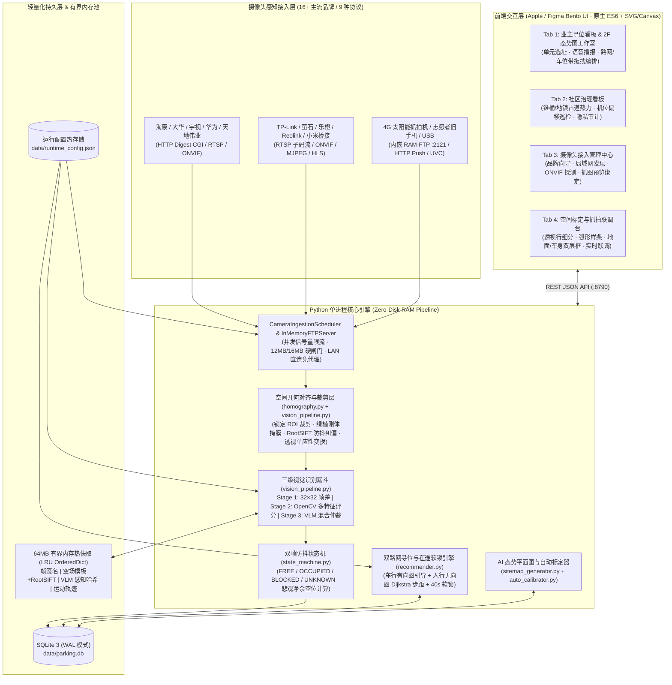
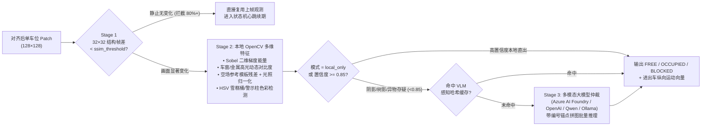

# 邻里停（Community Parking）系统方案、架构设计与关键技术说明文档

本文档全面阐述「邻里停 · 社区公益智能寻位系统」的**整体方案设计、分层系统架构、核心算法原理、零落盘内存安全防护、主流摄像头接入机制、车行/人行双路网寻位模型，以及当前手机端适配现状与演进规划**。

---

## 1. 方案背景与核心设计原则

开放式小区与老旧社区普遍面临「地面车位分散、树荫遮挡严重、物业无预算加装地磁/高位道闸、居民对公共摄像头录像落盘存在隐私顾虑」四大痛点。本系统围绕以下五项工程原则构建：

1. **零实景落盘（Zero-Disk Privacy by Design）**：所有视频抽帧、FTP 推图与 HTTP 抓拍全程在内存（`bytes` / `bytearray` / `numpy.ndarray`）完成解码与车位局部裁剪，推理结束立即销毁原图缓冲，`raw_images_written_to_disk` 恒等于 `0`；页面态势图仅展示抽象几何色块与车位编号，不回显监控实景、不识别车牌与人脸。
2. **宁少勿多，绝不虚报空位（Pessimistic Net-Free Accounting）**：针对过路车遮挡与车灯干扰采用双帧防抖状态机；但一旦首帧观测到空闲车位出现车辆或占道物（进入 `PENDING` 观察态），净余车位**立即扣减**；反之，车辆驶离必须等防抖复核通过后才释放为空位，彻底杜绝把车主引导到已被占车位的空跑体验。
3. **三级视觉漏斗（3-Stage Vision Funnel）**：通过「32×32 结构帧差门控 -> 本地毫秒级多特征 OpenCV 几何/纹理/模板判别 -> 多模态大模型（VLM）低置信度兜底仲裁 + 感知缓存」，节省 90% 以上云端 Token 消耗，且在断网或无 Token 时可无缝退化为纯本地模式。
4. **车行导航与人行步距解耦（2F Dual-Network Topology）**：车辆进场遵循单/双向行车环路方向引导，而车位推荐排序以**车位到目标单元门的真实人行道路距离**（支持人行步道及车行道双向步行）为核心指标，并辅以 40 秒在途软锁定防止多车争抢同一孤立空位。
5. **超轻量跨平台单进程架构**：无 Redis、无 Kafka、无重型深度学习 GPU 框架依赖，仅依赖 Python 标准库 + `OpenCV-Headless` + `NumPy` + `Pillow` + `SQLite (WAL)`，可在 macOS M 芯片、Windows（x86/ARM）及百元级 Linux ARM 边缘盒子长期稳定常驻（内存占用 `< 300 MB`）。

---

## 2. 总体系统架构设计

### 2.1 分层架构图

### 2.2 代码模块职责矩阵

| 模块路径 | 核心职责 |
| :--- | :--- |
| `run.py` | CLI 入口，解析 `--host` / `--port` / `--ftp-port` 参数，拉起内嵌异步内存 FTP 服务与多线程 HTTP 服务 |
| `app/config.py` | 线程安全 `ConfigManager`，管理运行参数热更新、API Key 掩码脱敏及历史版本配置幂等自动迁移 |
| `app/database.py` | SQLite WAL 存储引擎、表结构平滑迁移、2F 车行/人行双路网图构建与 Dijkstra 真实步行距离矩阵重算、机位与平面图 `spot_group` 原子绑定/解绑 |
| `app/camera_ingestor.py` | 16+ 主流摄像头厂商预设库、URL 模板渲染、局域网扫描与 UDP WS-Discovery、ONVIF SOAP 1.2 探测、HTTP Digest/Basic 抓图、RTSP/MJPEG/HLS/USB 内存抽帧及 `CameraIngestionScheduler` 后台轮询器 |
| `app/ftp_receiver.py` | 基于 `asyncio` 的零落盘内存 FTP 服务器（支持 `PASV` / `EPSV` / `STOR` 直入 `bytearray`，单图硬上限 15MB） |
| `app/homography.py` | 2D 射影单应性变换（`cv2.getPerspectiveTransform`）透视车位等分、近大远小 $\gamma$ 补偿、Catmull-Rom 样条弧形车位细分、三维车身包络框（Vehicle Envelope）几何推导与标准化 Patch 提取 |
| `app/vision_pipeline.py` | 图像并发解码限流、锁定区域 `crop_roi` 智能裁剪、绿植刚体掩膜、RootSIFT 相机晃动/变焦自动对齐、三级视觉漏斗、纵向进出车运动趋势估计及 64MB 有界内存缓存池治理 |
| `app/auto_calibrator.py` | 基于 VLM + OpenCV 几何辅助的摄像头画面车位自动发现与初始多边形标定建议 |
| `app/state_machine.py` | 四态双帧防抖状态机、悲观净余空位计算（`compute_pessimistic_effective`）、障碍物语义分级（固定占道/可挪动物品/临时行人宠物） |
| `app/recommender.py` | 片区聚合统计（粗粒度 `zone_id` 汇总 + 细粒度 `spot_group` 备选拆分）、单元门真实步距推荐排序、车行路径截取引导、40s 在途软锁管理与自然语言语音播报文案生成 |
| `app/sitemap_generator.py` | 上传小区平面图后的多模态 AI 结构化拓扑提取（大门、道路、单元楼、停车区）及无大模型时的 OpenCV 轮廓/色块几何回退 |
| `app/camera_naming.py` | 社区规范化机位编码解析/生成、标准车型尺寸预设（轿车、SUV、紧凑车、45° 斜列、横向顺停带）与车行引导路径截取 |
| `app/server.py` | 基于 `ThreadingHTTPServer` 的 RESTful API 路由控制器、16MB 请求体防爆拦截、静态资源托管与摄像头推送鉴权 |
| `static/` | 零构建步骤（Zero-Build）原生前端：`index.html` + `styles.css` + `app.js` |

---

## 3. 关键技术详解

### 3.1 零落盘隐私保护与多层内存防爆机制

为防止高分辨率摄像头抓图、异常超大报文或长期运行缓存累积耗尽主机内存（OOM），系统在全链路实施了 **6 道硬性内存护栏**：

1. **网络入口硬上限**：
   - HTTP 请求体读取（`app/server.py`）设置 `MAX_HTTP_BODY_BYTES = 16 MB`，无论是 `Content-Length` 预检还是 Base64 解码后字节数超限，立即抛出 `PayloadTooLargeError` 返回 `HTTP 413`，拒绝分配大块缓冲。
   - 内存 FTP 接收器（`app/ftp_receiver.py`）设置 `MAX_SNAPSHOT_BYTES = 15 MB`；主动拉流器（`app/camera_ingestor.py`）设置单帧 `MAX_PULL_IMAGE_BYTES = 12 MB`、MJPEG 环形扫描上限 `4 MB`。
2. **并发解码信号量限流**：
   - 主动流媒体抽帧限制 `MAX_CONCURRENT_PULLS = 2`；
   - 全图 OpenCV 解码限制 `MAX_CONCURRENT_IMAGE_DECODES = 4`；
   - 云端 VLM 并发请求限制 `MAX_CONCURRENT_VLM_CALLS = 4`（兼顾速率配额与内存峰值）。
3. **超清画面内存即时降采样**：
   - 4K / 800 万像素摄像头画面进入内存解码后，若长边超过 `1920px`（拉流器）/ `2560px`（推理管线），立即在内存中等比缩放到安全分辨率并释放原始大图数组；上传的小区平面底图自动压缩长边 `<= 1200px` JPEG。
4. **瞬时裁剪与显式缓冲释放**：
   - 全图仅在提取各车位 `128×128` 局部 Patch 期间存活，裁剪完毕后原图 `ndarray` 与临时 `extracted_patches` 立即离开作用域回收。
5. **6 类有界 LRU 内存池与 64MB 总预算动态收缩**：
   - `_prev_signatures`（`OrderedDict`，上限 `4096` 个 `32×32` 灰度签名）
   - `_template_cache`（上限 `32` 路机位空场参考底板 + 预提取 RootSIFT 特征点）
   - `_vlm_result_cache`（上限 `1024` 条感知哈希判决缓存，默认 TTL `900s`）
   - `_latest_check_frames`（上限 `16` 路 `320px` 巡检缩略灰度帧，单帧约 `55 KB`）
   - `_spot_motion_tracks`（上限 `1024` 条车位纵向质心运动向量）
   - `_dynamic_roi_cache`（上限 `64` 条大风/变焦动态 ROI 锚点缓存）
   - 每次写入后核算总字节数，超出 `cache_budget_mb`（默认 `64 MB`）自动按 LRU 淘汰最旧条目，并在 `/api/overview` 的 `privacy_stats` 实时向前端汇报精确 KB/MB 占用。

---

### 3.2 主流摄像头多协议接入与自动发现引擎

`app/camera_ingestor.py` 针对小区复杂混装现状（既有物业海康/大华 NVR，也有家用 Tapo/萤石/小米摄像头，甚至无网线死角的 4G 太阳能相机或志愿者旧手机），设计了统一的**「预设模板 + 主动拉取 / 被动接收双模引擎」**：

- **16 类厂商预设与通道编码自动换算**：
  - 例如海康威视 IPC/NVR 自动按 `hik_channel = channel * 100 + (1 if main else 2)` 生成第 1 路子码流 `102`、第 3 路子码流 `302` 的 ISAPI 抓图地址 `/ISAPI/Streaming/channels/302/picture` 与 RTSP 地址；
  - 大华自动生成 `/cgi-bin/snapshot.cgi?channel=N&subtype=1`；TP-Link Tapo 映射 `/stream1` / `/stream2`；兼容萤石、乐橙、宇视、华为好望、天地伟业、Reolink、Axis/韩华、小米 `go2rtc/Scrypted` 桥接等。
- **局域网免代理与多认证协议栈**：
  - 私网 IP（`192.168.x.x` / `10.x.x.x` / `172.16-31.x.x` / `.local`）自动挂载 `urllib.request.ProxyHandler({})`，彻底规避宿主机系统代理把内网摄像头请求转发到外网导致超时。
  - 原生支持 **HTTP Digest（摘要认证，安防相机默认）**、**HTTP Basic**、**Bearer Token** 与 URL Query Token。
- **RTSP 按需瞬时抽帧（非持续解码保活）**：
  - 先通过毫秒级 TCP Socket 预检目标 `rtsp_port` 连通性（离线机位快速失败，不卡死 FFmpeg 线程），再通过 `OPENCV_FFMPEG_CAPTURE_OPTIONS` 注入 `rtsp_transport;tcp|stimeout;5000000` 抽取最新关键帧后立即 `cap.release()` 断开流连接，使 20 路摄像头的 CPU 均值占用不到持续拉流方案的 5%。
- **零依赖 ONVIF SOAP 1.2 探测与局域网发现**：
  - 纯标准库构造 WS-UsernameToken PasswordDigest 头与 SOAP 1.2 报文，依次查询 `GetDeviceInformation`、`GetProfiles`、`GetSnapshotUri`、`GetStreamUri` 自动回填真实地址；
  - 支持 UDP `239.255.255.250:3702` WS-Discovery 多播发现与同网段并发端口指纹扫描（`80 / 554 / 8000 / 8080 / 8554 / 8899`）。
- **凭证安全脱敏**：
  - 数据库存储 `ingest_config_json`；所有对外 GET 接口统一经过 `redact_ingest_config()` 剥离明文密码与 URL 内嵌 `user:pass@`，仅返回 `has_password: true` 与掩码，前端编辑未重填密码时后端自动保留原密码。

---

### 3.3 空间几何标定、双层多边形与抗抖动视觉对齐

社区高空俯拍或斜拍机位普遍存在**强烈近大远小透视畸变**、**车身三维高度越界投影**以及**刮风/热胀冷缩引起支架轻微偏移**：

1. **2D 射影单应性透视细分（`subdivide_perspective_row`）与弧形样条细分**：
   - 用户只需框选一整排车位外轮廓四顶点 $[P_0, P_1, P_2, P_3]$，系统求解单位正方形 $[0,1]^2$ 到透视四边形的单应性矩阵 $H$，并引入透视压缩指数 $\gamma \in [0.35, 2.8]$（$u_i = (i/N)^\gamma$）与车位间隙比，一键生成符合近大远小透视规律的 $N$ 个梯形车位格；弯道车位支持沿 Catmull-Rom 样条中心线按弧长等分法向展开。
2. **地面框（Ground Polygon）与三维车身包络框（Vehicle Envelope Polygon）双层几何**：
   - 斜拍视角下，停入本车位的 SUV 车顶/车尾会向上方与远端延伸出地面白线框；而仅框地面又容易漏检深色车身，框太大则会蹭到隔壁车位造成「邻位串扰（5 号位被 4 号车误判占用）」。
   - 系统将每个车位建模为双多边形：`polygon` 严格贴合地面标线用于路面纹理与邻位隔离；`vehicle_polygon` 自动按视角方向推导三维车身包络用于全局车型语义辅助，支持前端联动或独立微调。
3. **抗绿植摇曳刚体掩膜 + RootSIFT 自动对齐（`vision_pipeline.py`）**：
   - 通过 HSV 色彩空间滤除 `[H: 33..89, S >= 44, V >= 26]` 的摇曳树冠与灌木，生成刚体结构掩膜（仅保留路沿、地砖、墙体、标线等不动参照物）；
   - 提取 SIFT 特征并经 L1 归一化平方根映射为 **RootSIFT（Hellinger 核）**，结合 RANSAC 估计刚体仿射/透视变换矩阵，在裁剪前将实时帧自动对齐回标定基准坐标系，并定期评估内点率（Inlier Ratio）与像素漂移量，超过阈值自动在「社区治理看板」发出相机偏移/起雾预警。

---

### 3.4 三级视觉识别漏斗（3-Stage Hybrid Vision Funnel）

- **原生兼容主流多模态接口**：`app/vision_pipeline.py` 自动识别并适配 Azure AI Foundry 最新 `/openai/responses` API、经典 `/chat/completions` Target URI、Serverless Models Endpoint、OpenAI 兼容接口及本地离线 Ollama，并具备失败自动降级回本地 OpenCV 能力，绝不因外网波动中断车位更新。
- **障碍物精细化语义分级**：区分真车停放（`OCCUPIED`）、地锁/石墩/锥桶恶意霸位（`BLOCKED` -> 推送物业治理看板）、临时可挪走小物件如儿童球/单车（`FREE + movable` 提示）及行人/猫狗经过（`FREE + pedestrian` 提示）。

---

### 3.5 双帧防抖状态机与悲观净余空位算法

每个车位维护已确认态 `(status, free_units)` 与待确认观察态 `(pending_status, pending_free_units, pending_since)`：

- **防抖翻转条件**：当新观测态与当前已确认态不一致时，首次仅写入 `pending_status` 并记录时间戳 `pending_since`；只有后续帧在 $t - \text{pending\_since} \ge \text{debounce\_seconds}$（默认 `3.0s`）仍观测到相同状态时才正式提交翻转；若中途恢复原状（如过路车驶过），立即清空 `pending_status`。
- **悲观净余空位公式（`SpotStateMachine.compute_pessimistic_effective`）**：
  - 若当前已确认态为 `FREE`，但 `pending_status` 为 `OCCUPIED` 或 `BLOCKED`：对外有效状态立即视为占用，有效空位 $\text{effective\_free} = 0$（弹性顺停带取 $\min(\text{committed\_free}, \text{pending\_free})$），平面图叠加紫色防抖虚线框提示「正在确认占用」；
  - 若当前已确认态为 `OCCUPIED` 或 `BLOCKED`，而 `pending_status` 为 `FREE`：在防抖窗口走完前仍保持 $\text{effective\_free} = 0$，确保前车彻底驶离后再向寻位车主释放空位。

---

### 3.6 2F 车行/人行双路网拓扑与单元门寻位推荐算法

针对小区「行车有单行环路限制，但业主停好车后步行回单元楼可走内部人行连廊且不受车行单向限制」的真实空间特征，系统在 `0..1000` 归一化平面图坐标系上构建了两套独立图结构：

1. **人行无向连通图 $G_{\text{walk}} = (V_w, E_w)$**：
   - 将平面图绘制的**人行步道（`pedestrian_paths`）**与**车行路径（`driving_routes`，忽略单行方向限制，双向可走人）**及内部道路交点自动吸附合并成连通无向图；
   - 车位带中心与各楼栋单元门（`units`）分别投影吸附到最近路网边，使用 **Dijkstra 最短路径算法**计算真实折线步行距离（米），取代失真的直线欧氏距离。
2. **车行有向引导图 $G_{\text{drive}}$**：
   - 严格遵守单向环路（`one_way = true`）与双向路段拓扑，结合小区出入口截取生成顺向绿色车行引导流向线。
3. **寻位综合代价函数与主备选防歧义策略**：
   $$\text{Cost}(z, u) = d_{\text{walk}}(z, u) + P_{\text{dead\_end}}(z) + P_{\text{suv\_compact}}(z, v) - 14.0 \times \min\big(\text{effective\_free}(z),\, 3\big)$$
   - 其中 $\text{effective\_free}(z) = \max\big(0,\, \text{raw\_free}(z) - \text{active\_soft\_locks}(z)\big)$。
   - **粗粒度片区汇总 + 细粒度备选拆分**：同一 `zone_id` 下若包含多条物理车位带（`spot_group`，如「6 号楼前排」与「6 号楼后排」），片区卡片按粗粒度 `zone_id` 合并统计宏观余量，而在寻位推荐与语音播报的备选列表中按独立 `spot_group` 拆分展示各自净余车位与步距，避免同一片区前后多排车位产生指引歧义。
   - **40 秒在途软锁定**：每次响应 `/api/recommend` 后自动为首选片区生成一条 TTL=`40s` 的内存软锁（上限 200 条自动过期清理），在途车辆占用的名额实时扣减，防止相邻入场车辆撞单。

---

## 4. 数据存储模型与核心 REST API

### 4.1 SQLite（WAL 模式）核心表结构

| 表名 | 主键 | 说明 |
| :--- | :--- | :--- |
| `units` | `unit_id` | 楼栋单元门台账及平面图归一化坐标 `(map_x, map_y)` |
| `zones` | `zone_id` | 停车片区属性（断头路惩罚、平面图位置/宽高/角度） |
| `unit_zone_dist` | `(unit_id, zone_id)` | 基于双路网拓扑自动重算的单元门—片区真实步行米数矩阵 |
| `cameras` | `camera_id` | 摄像头台账、关联片区、绑定平面图车位组 `spot_group`、空场模板 `reference_jpeg`、锁定 `crop_roi_json`、拉流配置 `ingest_config_json`、运行健康度 `calib_health_json` |
| `spots` | `spot_id` | 车位标定地面框 `polygon_json`、车身包络框 `vehicle_polygon_json`、平面图几何坐标、实时四态与 `pending_*` 防抖字段、障碍物分类提示 |
| `site_map` | `id = 1` | 单例表，保存小区大门 `gates_json`、内部道路 `roads_json`（含车行路线与人行步道）、脱敏平面底图及宽高比 |

### 4.2 核心接口速览

| 分类 | 方法与路径 | 功能说明 |
| :--- | :--- | :--- |
| **监控与总览** | `GET /api/health`、`GET /api/overview` | 服务存活探针；全量片区态势、车位实时投影、软锁列表、机位偏移汇总及内存隐私缓存指标 |
| **业主寻位** | `GET/POST /api/recommend`、`GET /api/recommend/voice`、`DELETE /api/locks` | 计算最优主选与细分备选车位带（POST 触发在途软锁）、生成语音播报文本、清空软锁 |
| **手机只读寻位专口 (`:18790`)** | `GET /`、`GET /api/mobile/overview`、`GET /api/mobile/recommend`、`GET /api/mobile/backdrop` | 独立端口只读同源服务：脱敏实时车位平面图、按每台手机目的地无锁计算步行寻位与语音文本，拦截一切后台管理与写入请求（`403`） |
| **平面图与路网** | `GET /api/sitemap`、`POST /api/sitemap/auto-generate`、`POST /api/sitemap/layout`、`POST /api/sitemap/generate-route-spots` | 读取/AI 生成平面图、保存路网与车位带自由布局、沿路径批量排布标准车型车位组 |
| **摄像头管理** | `GET /api/cameras/presets`、`POST /api/cameras/preview-url`、`POST /api/cameras/discover`、`POST /api/cameras/onvif-probe`、`POST /api/cameras/test-connection` | 16+ 品牌预设查询、地址预览生成、局域网自动发现、ONVIF 探测、零落盘实抓图连通性测试 |
| **机位台账与绑定** | `GET/POST /api/cameras`、`PUT/DELETE /api/cameras/<id>`、`POST /api/cameras/<id>/bind-floorplan`、`POST /api/cameras/<id>/unbind`、`POST /api/cameras/<id>/pull-now` | 新增/编辑/删除摄像头、与 2F 平面图车位组原子绑定或解绑、手动触发立即拉流识别 |
| **空间标定与推图** | `POST /api/cameras/<id>/calibrate`、`POST /api/cameras/<id>/auto-calibrate`、`POST /api/cameras/<id>/snapshot` | 保存多边形标定与空场模板、AI 自动标定建议、接收外部 HTTP/Webhook 抓拍推图（支持 `X-Camera-Token`） |
| **系统配置** | `GET/POST /api/config`、`POST /api/vlm/test` | 在线读取（脱敏）与热更新运行配置、测试多模态大模型连通性 |

---

## 5. 手机端专属只读寻位端口（`:18790`）架构设计

为避免把复杂的后台管理界面（摄像头接入、多边形标定、模型配置）暴露给普通业主，同时免去开发与审核微信小程序的维护负担，系统在单进程内采用**双端口职责分离架构**：

### 5.1 管理端（`:8790`）与业主手机端（`:18790`）双端口隔离

1. **零内存拷贝共享上下文**：
   - `run.py` 在同一进程中共享同一个 `ParkingAppContext`（SQLite WAL + 状态机 + 寻位引擎），同时拉起 `:8790` 管理控制台与 `:18790`（默认绑定 `0.0.0.0:18790`）手机只读 HTTP 服务，不增加任何额外进程或数据库锁开销。
2. **硬隔离只读白名单与隐私脱敏**：
   - `:18790` 的 `MobileHTTPHandler` 仅允许读取 `mobile.html / mobile.css / mobile.js / manifest.webmanifest` 及 `/api/health`、`/api/mobile/overview`、`/api/mobile/recommend`、`/api/mobile/backdrop`；任何 `POST / PUT / DELETE` 写入操作或后台 `/api/cameras`、`/api/config` 请求一律返回 `HTTP 403`。
   - `/api/mobile/overview` 输出前自动剥离所有摄像头的 IP、RTSP/HTTP URL、账号信息及大模型配置，仅向手机端下发平面图矢量路网、单元门坐标与车位红绿实时状态。
3. **无软锁污染并发读取（`acquire_lock=False`）**：
   - 手机端持续轮询或多人同时查看 `:18790` 时，后端寻位引擎强制以只读模式（`acquire_lock=False`）计算每个人各自目的地的推荐路线与语音文本，绝不会因几十位邻居同时看手机而误冻结在途软锁名额。

### 5.2 极简手机端交互与可配置多遍/持续语音播报

1. **纯粹聚焦两件事：「目的地语音播报 + 实时态势平面图」**：
   - 手机打开 `http://<局域网IP>:18790` 即全屏呈现目的地单元选择（支持下拉选择或**直接轻触平面图上的楼栋/单元门图标切换**），每台手机的选择通过 `localStorage` 与 URL `?unit=` 参数在本地独立持久记忆，不同业主互不干扰。
2. **支持 `1遍` / `2遍` / `静音` 与 `持续播报` 组合设置**：
   - 内置适配移动端 WebKit / Chromium 的多遍语音状态机（含首触自动解锁音频上下文、双遍间隔停顿、回调丢失看门狗保护及车载常亮 `Screen WakeLock`）：
     - **1遍 / 2遍**：切换目的地、车位推荐发生变化或点击「🔊 播报」时，自动清晰播报 1 遍或连续播报 2 遍（实时显示 `1/2`、`2/2` 进度，随时可一键停止）。
     - **持续播报开关**：开启后在驶入小区途中持续监测车位变化并周期自动播报最新空位与步行距离，解放驾驶员双手；支持添加到手机主屏幕（PWA 全屏模式）。
3. **移动端原生 Pointer 手势平面图**：
   - 1:1 还原 2F 车行环路单双向箭头、人行步道、行车引导线、到目标单元门的步行虚线及旋转车位框，原生支持**单指拖拽平移、双指捏合缩放（`1x ~ 4.5x`）与轻触车位状态微提示**。
